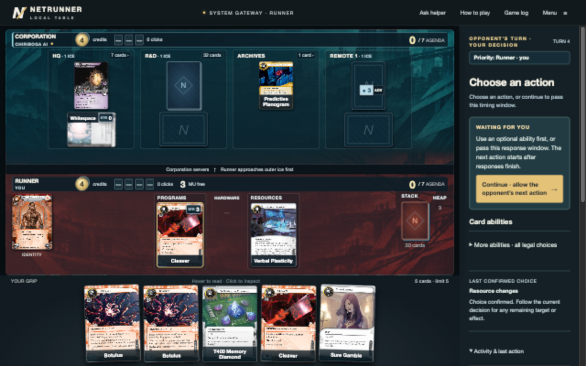
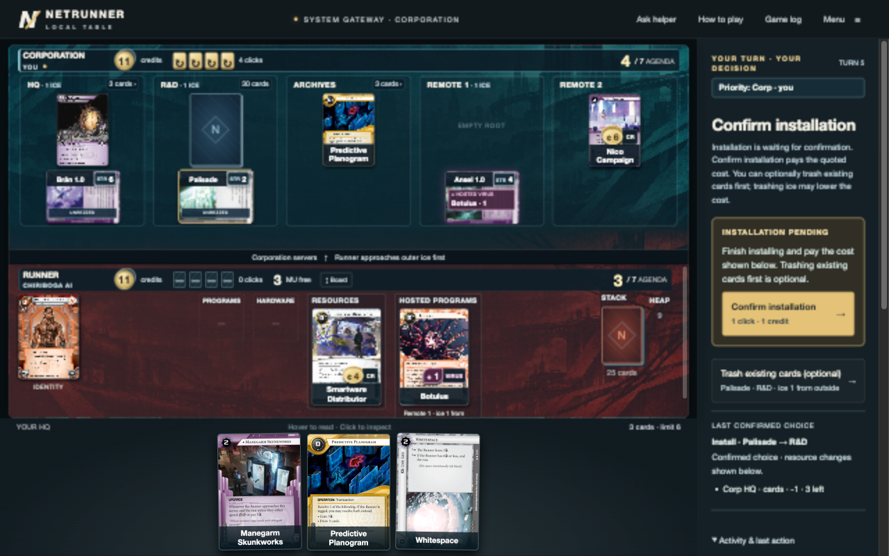
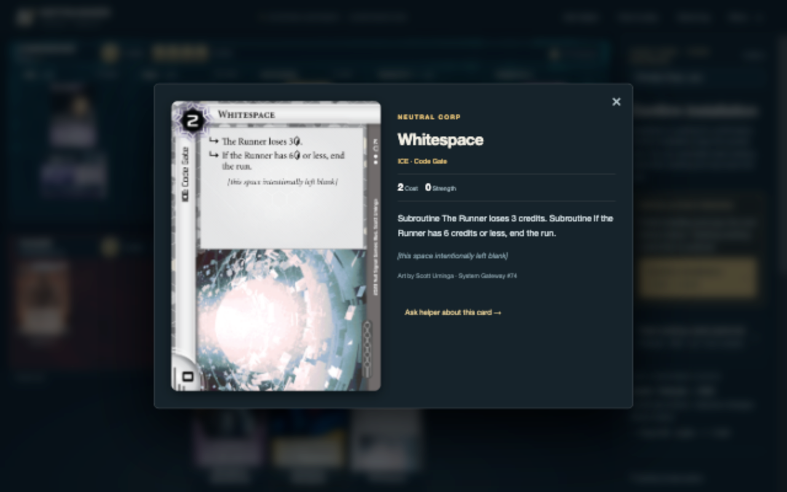

# Full-game interface click audit — 2026-11-08

The clearest avoidable burden is response-window interruption, especially outside a run. Moving Cleaver boosts into a collapsed menu reduced clutter but did not stop those abilities from demanding repeated passes. Installation also changes surfaces halfway through the action: the card modal closes before the player has committed the installation in the sidebar.

## Method and scope

Played two complete normal games against the built-in AI through browser controls, one as each side. Both used Loup v1 and Precision Design v2, rules `26.03-local-2`, at 1280×800. Corp kept its hand; Runner took a mulligan. No engine commands, custom positions, undo, or concessions were used to play the matches. All actions went through visible interface controls. Read-only public state was used to inspect the current position and save replays.

The Chrome extension reported **“The browser access host is unavailable.”** Used the previously authorized shared browser instead: Chromium 152 / Electron 44 / T3CodeBeta 0.1.7. These results are desktop browser-flow evidence, not a successful Chrome-extension connection test. Incognito tabs kept these games separate from the user's normal-profile saved game. Test tabs were closed afterward; the local game server remains running.

Counts are actual button/summary activations, captured before game handlers ran. Native select changes were also instrumented, but no deck selectors were changed. Setup and opening-hand choices are included and broken out below. Failed automation requests for controls absent from the current phase did not dispatch DOM clicks and are excluded. No playback Next/Skip clicks were used. Runner encountered two automatic presentation pauses, resumed through the visible Resume button.

This is one exploratory pilot per side, not a novice study or an optimal-play minimum. Some draw/economy choices were inefficient; those remain game actions, not UI overhead. Agent reading/tool time makes elapsed match duration unsuitable as a human-speed measurement. There was no before-build control, so this audit cannot quantify a regression from the older version.

## Complete match results

| Measure | Human Corp | Human Runner |
|---|---:|---:|
| Final Corp–Runner agenda points | 7–5 | 0–7 |
| Human turn reached | Corp 11 | Runner 7 |
| All interface activations | **107** | **97** |
| Game actions / choices | 71 | 43 |
| Card reading and action navigation | 18 | 13 |
| Pass / advance controls | 10 | 32 |
| Separate install confirmations | 3 | 3 |
| Break-plan review | 0 | 2 |
| Automatic playback-pause resumes | 0 | 2 |
| Setup / opening hand | 3 | 2 |
| Deliberate install-recovery probe | 2 | 0 |

Categories are mutually exclusive and sum to each total. “Game actions / choices” includes some effect acknowledgements; it is not a claim that all 71/43 clicks are intrinsically necessary. Navigation can be useful reading. Passes include useful jack-out and risk checkpoints. **Do not label all 204 activations unnecessary.** Excluding setup and the deliberate probe leaves 102 Corp and 95 Runner activations during ordinary play.

The replays contain 85 Corp and 108 Runner native choice records. Native choice counts differ from interface clicks: frontend assistance can emit multiple native choices for one click, and automatic native passes are recorded too. These are not an alternate click count.

## Findings, in recommended implementation order

### 1. Skip narrowly identified boost-only windows outside encounters

**24 of 97 Runner activations (24.7%)** were Continue clicks outside a run, with Cleaver's boost as the only legal alternative. The ability was under More abilities; it still stopped play. This happened in three repeated chains of eight: activations **22–29, 45–52, 62–69**. Each chain covered Runner discard response, Corp draw/action start, three Corp post-action windows, Corp discard response, and Runner turn start. Eighteen of the 24 clicks occurred during the opponent's turn.

Example: after discarding a duplicate Cleaver at activation 21, eight passes were required before the next Runner action. The interface repeatedly said “WAITING FOR YOU” and “allow the opponent's next action,” even though the only other option was a temporary strength boost outside a run.

Implementation reference: `engine/adapter.js:quietWindowEligible` currently restricts assistance to Runner post-action and run initiation/approach windows on the Runner's own turn. That narrow whitelist leaves these windows uncovered. `app/interaction.mjs:secondaryAbility` controls visual placement separately, explaining why hiding the button did not remove the pauses.

**Proposed behavior:** default to a native pass when every alternative is a known Gateway breaker boost whose strength expires without an encounter. Preserve the actual priority sequence, replay records, and a full-control/hold-priority preference. Do not generalize this to arbitrary paid abilities or skip decisions involving costs, targets, encounters, or jack-out. Under the same choices, this alone would remove the need for 24 human activations; that is a counterfactual UI saving, not a measured patched-game result.

### 2. Finish installation where it starts

Six installs required a separate sidebar confirmation: Corp **48, 58, 71** and Runner **7, 60, 78**. The initiating modal had already closed. This occurs even when the existing-card trash choice is optional and enough space is available.

Reproduction from the actual Corp game:

1. Open Palisade from hand (44).
2. Select Install → R&D (45). Modal closes; Palisade is pending, not installed.
3. Open another hand card, Whitespace (46). Its modal has **no action buttons and no pending-install explanation**; the needed confirmation is behind the overlay.
4. Close Whitespace (47), then Confirm installation in the sidebar (48).

Steps 3–4 were a deliberate two-click recovery probe, not a spontaneous error, and are classified separately. They directly reproduce the user's reported dead end. A failed attempt to locate Play while the Runner install was pending likewise found that the action was unavailable, but did not dispatch a click.

**Proposed behavior:** show destination, final cost, optional replacements, and the commit action together in the install modal. Quote the actual server ICE cost on the destination action. Use “Install in R&D · 1 click + 1 credit” as the final commit when the complete quote is known; place “Replace/trash installed cards…” alongside it as an explicit secondary branch. If a separate confirmation is required, retain the modal and put it there. Any other card inspector opened while installation is pending must show “Finish installing Palisade” with a direct route to the pending action.

Keep optional trash/replacement. It was useful later: Corp deliberately replaced Ansel with Whitespace at **94–95** to remove the AI's hosted Botulus. Deleting that choice would remove strategy. One-surface completion is the first requirement; eliminating a duplicate confirmation is appropriate only when the earlier button already provides the final quote and replacement policy.

### 3. Make optional rez and paid abilities contextual

All **10 Corp pass/advance activations** had an optional ability as the only alternative. Five were associated with unrezzed Manegarm (**60–64**), five with Spin Doctor's shuffle ability (**83, 85–88**). Two were End action phase, so they also served a useful explicit end-turn function. Six further response passes occurred outside a run; two were early run windows. These are opportunities to streamline defaults, not ten universally pointless choices.

Manegarm was deliberately left unrezzed until the run approached its server, then rezzed at **65** and resolved at **66**. Those were relevant defensive interactions. Spin Doctor's shuffle was also used later to clear the scoring server and recover a card (**90–92**). Merely hiding either ability while retaining every stop would repeat the Cleaver problem.

**Proposed behavior:** card-local actions and an “Other paid abilities / Hold priority” affordance during ordinary play; prominent defensive rez choices when the attacked server or relevant timing makes them useful. Retain a deliberate End turn control. Allow players to request earlier or broader priority stops for tricks. Use card-aware policies and explicit player preferences; blanket auto-passing every non-run rez/paid-ability window would suppress real options.

### 4. Resolve effects that offer no decision, with a visible receipt

The Corp manually acknowledged Nico's payout (**33**), Spin Doctor's mandatory draw (**80**), and Manegarm's mandatory approach effect (**66**). Later, Whitespace's two unbroken subroutines required individual triggers (**103–104**). These five clicks offered no target or alternate action in the public decision at that moment.

Prefer automatic resolution with clear credit/card/click changes and readable activity entries once relevant responses finish. Preserve ordering choices where multiple effects compete: Luminal plus Precision Design at **38–39** is a reason not to apply a blanket “single-looking effect” rule. Optional identity recovery and free rez still need a decision; opening their target chooser directly may save a setup click without choosing for the player.

### 5. Reduce run fragmentation without erasing decisions

The first successful remote run took **nine activations (32–39, 42)**, plus two optional card-reading activations (40–41): open run picker, choose server, review break, confirm boost, break subroutine, pass encounter, continue movement, choose the only access card, steal. Movement preserved a real jack-out choice; boost and break spent distinct committed costs. The sequence is still long for one ice and one card.

Offer a clearly quoted “Break all with Cleaver · 3 credits” path that carries out the selected plan through currently offered choices and pauses when the cost, target, or opponent response changes. Keep manual selection for partial breaks and unusual timing. Fold a single-card breach selection into revealing the access decision when access ordering cannot matter. Keep card reading and steal/trash decisions visible; do not silently advance past an unseen card.

Two later encounters automatically paused playback (**83, 94**) and required Resume even though no further legal paid response remained. `app/opponent.mjs` deliberately inserts an encounter-review beat. Use a brief automatic readable beat by default, with a teaching-mode preference to stop, rather than making playback resume a second advancement mechanism. One pause followed an all-broken Palisade and was particularly unhelpful.

“Read full card” opened the accessed Send a Message correctly at **40**. This covers that remote access path; it does not establish that every HQ/multi-access inspector route works.

## Acceptance criteria for a follow-up build

- Same boost-only situations progress with zero human Continue clicks in assisted mode; full control restores the legal windows.
- Installing from a card modal ends with either a completed installation or a visible next step in that same modal. Opening another card never produces an unexplained actionless inspector.
- Optional replacement remains available before commit; Botulus removal by replacing its host still works.
- Ordinary opponent turns do not need repeated passes for irrelevant boosts. Relevant defensive rez, genuine paid effects, jack-out, and access ordering remain available.
- Forced receipts explain their resource changes; simultaneous effects still allow ordering where it matters.
- No extra Resume is needed after an all-broken encounter in the default flow.
- Repeat two fresh complete browser games after changes. Do not claim total savings from replay-only analysis or compare raw totals across different strategic games as if they were controlled benchmarks.

## Evidence and verification

- [Corp browser activation log, config, native replay, final state](../../eval/click-audit/corp.json)
- [Runner browser activation log, config, native replay, final state](../../eval/click-audit/runner.json)
- [Corp classified events](../../eval/click-audit/corp-analysis.json)
- [Runner classified events](../../eval/click-audit/runner-analysis.json)
- [Reproducible analyzer](../../scripts/analyze-browser-click-audit.cjs): `node scripts/analyze-browser-click-audit.cjs`
- [Corp result](../../eval/click-audit/corp-result.png), [Runner result](../../eval/click-audit/runner-result.png), [paused playback](../../eval/click-audit/playback-paused.png)

Offline replay of both captured sessions reproduced the terminal winner and both agenda scores with zero engine diagnostics. Replay was used only after the browser matches to verify records and reconstruct public option metadata for the first 58 Corp activations. No gameplay code changed during this baseline audit.
